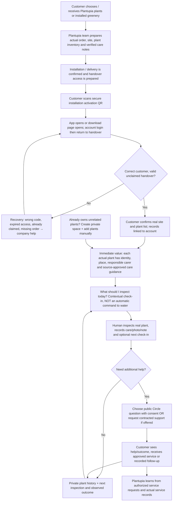
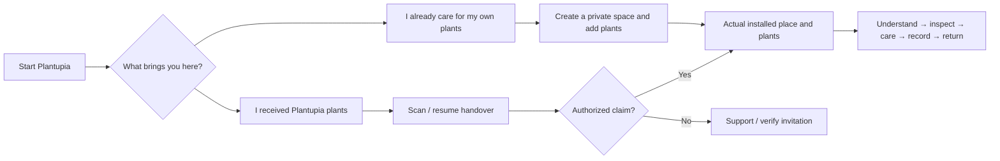

# Plantupia — End-to-end customer journey & service blueprint
**20 October 2026 · CEO discovery/decision draft · NOT an approved commercial promise or shipped feature**

## The question the CEO actually asked

> If someone buys or receives plants from Plantupia, how do they start caring for *their actual plants* without entering everything from scratch? Where does customer value appear, and how does the company sustain the relationship afterward?

**Product thesis:** Physical delivery becomes a persistent, consented relationship between customer, actual place, individual plants, sourced care guidance, real human actions and Plantupia's legitimate support/service responsibility.

**Separate known implementation from proposed handover.** The Android app currently supports manual private places and plants, real care/observations/photos, human-chosen check-ins, history and separately consented Circle posts. There is no verified production customer, service SLA, QR activation/claim workflow, curated approved species-care library or ready-made installation-provisioning model in the inspected repo.

## 1. One CEO-readable end-to-end journey

The **manual route must remain** available: an individual without a Plantupia purchase should still be able to start their own private place and plants without a QR, order or subscription.

## 2. Three-party service blueprint: customer / company / product

| Stage | Customer sees/does | Plantupia team actually does | App/backend responsibility | Reality today |
| --- | --- | --- | --- | --- |
| Discovery, purchase or agreement | Understands whether this is ownership, installation, or ongoing maintenance | Confirms offer, scope and who cares for plants | Clear entry and terms, no automatic commercial claim | **COMPANY FACTS REQUIRED** |
| Before delivery | No manual list entry required | Creates a genuine order/site and the **individual delivered plants**, confirms species if known, placement and source-approved initial guidance | Provisioned records in installation batch, not fictitious fixtures | **GAP — no provisioner/installation batch** |
| Handover | Scans one **handover activation QR**, signs in, verifies plant list | Confirms delivered list and rightful recipient | Deep link, secure one-time claim, authorized ownership/member mapping, failure/recovery | **GAP — no QR/claim endpoint** |
| First useful minute | Sees actual place and plants, photo, care guide, next meaningful inspection | Provides guide and clarifies who owns routine care | **My Space** and **Care Guide** shown for confirmed plants | **PARTIAL — My Space built; sourced guide absent** |
| Day-to-day | Checks soil/light/visible condition; records real action | If contracted, staff see only permitted assigned work | Check-in, action, real image and dated private event | **BUILT IN SOURCE — device/service QA still open** |
| When something goes wrong | Understands next safe action; chooses help | Replies under real support arrangements or staff assignment | Private support case vs opt-in public Circle question | **PARTIAL public/private advice; staffed support gated** |
| Maintenance / replacement | Sees factual last visit, work done, replacement and follow-up | Logs authorized work; records replacement as **new biological plant identity** | Service visit, work proof, handover, service status | **GAP / COMPANY-GATED** |
| Continuity | History persists, remains useful after months, can end/revoke access | Learns from eligible support/service outcomes without violating consent | Retention, permission revocation, export, quality metrics | **PARTIAL history; commercial lifecycle unverified** |

## 3. The QR is an activation/claim link, not a magic plant scanner

**Proposal to validate with operations:**

1. A staff member **prepares** an installation batch (order/site reference, delivered plant-unit IDs, optional real photos, verified species or `unknown`, real placement, guide version and responsibilities).
2. Company issues a short-lived, single-use, high-entropy **handover invitation**, ideally via a verified customer channel. QR opens an official HTTPS landing URL and a verified Android App Link when installed. Uninstalled users can install then resume safely.
3. Customer signs in / creates account, sees a **non-sensitive handover confirmation**: e.g. "1 office space · 7 plants", and confirms claim. Backend validates claim rights, expiration, replay/duplicate claims and existing memberships before returning any private inventory.
4. Existing `Space`/`PlantUnit` objects are **assigned or shared**, not re-created seven times. The same individual plant ID follows care history and moves. An expired/incorrect/already-claimed code has an explicit recovery and contact route.
5. **Do not put a permanent ownership-token QR on the pot.** An optional permanent per-plant QR should be a non-secret asset identifier that requires a currently authorized account to view private plant detail; it must not grant membership on its own. Handover QR and daily plant label have different threat models.
6. For a site cared for by Plantupia, roles and responsibility are determined by company-approved work rules, not by whoever happens to scan first. QR does not publish private site details or permit strangers to claim a customer environment.

**Security rationale (general pattern, applied as a proposal—not a copied password-reset endpoint):** Random high-entropy, expiring, single-use claim tokens and HTTPS + rate limits follow [OWASP token practices](https://cheatsheetseries.owasp.org/cheatsheets/Forgot_Password_Cheat_Sheet.html). Verified deep links follow [Android App Links](https://developer.android.com/training/app-links/about). Domain, Android app-signing ownership and company approvals must be verified before implementation.

## 4. Plant care: useful from the start without biologically false promises

**This was a real product gap.** The present Plantupia app records a *human-chosen check-in date*; it does not currently contain an approved botanical species guide or validated automatic watering engine. The app cannot truthfully say a species *must be watered every seven days* based on its name alone.

A **sourced care profile** per known plant species (with provenance, review date and responsible approver) should cover: light exposure, substrate/drainage checks, signs that watering might be appropriate, how to inspect soil, pruning/fertilizer cautions, known safety warnings if sourced, and what to do when identity or conditions are unknown. A **plant-specific care context** adds its pot/placement/environment, responsible carer and company-maintained vs customer-maintained arrangement. These are distinct objects.

A first-use UI example (not yet coded):

- **Your office · 7 plants** — the genuine delivered inventory.
- **Ficus elastica · by the north window** — if the species/placement were actually verified by staff; otherwise say "Species to confirm."
- **Next: Check soil moisture** — an inspection suggestion *based on an approved care profile*, not a universal instruction to water now.
- **What to do:** inspect soil and leaf condition; if unsure, see a short referenced guide or ask for help.
- **Log what you did** — "Checked soil", "Watered", "Not now" (not a fabricated watering event). Optionally record photo, notes and human-selected follow-up.
- **Who cares for this plant?** Customer / Plantupia / shared, **only once contract and role ownership have been approved**.

University horticultural guidance explains why soil inspection and actual site conditions matter more than rigid watering calendars: [Iowa State University Extension](https://yardandgarden.extension.iastate.edu/how-to/how-care-houseplants), [University of Illinois Extension](https://extension.illinois.edu/houseplants/watering), [UConn Extension](https://extension.uconn.edu/2013/12/24/watering-houseplants/). Company botanical specialists should approve content and exceptions, especially when conditions or species are uncertain.

## 5. The dual entry is not optional

This preserves the C0 independent consumer product and adds B1 commercial onboarding only after the operational handover is verified. Do not make purchasing from Plantupia a requirement for using the core app.

## 6. Actual code mapping (inspected 20 October)

| Existing source | What it proves | What it does **not** prove |
| --- | --- | --- |
| `backend/plants/models.py`: `Space`, `SpaceMember`, `PlantUnit`, `PlantEvent`, `PlantDiscussion` | Private place/plant/role/event model exists | There is no shipment, installation handover, QR redemption or approved care-guide model here |
| `backend/plants/urls.py` | Authenticated spaces, plants, event/photo, questions, assistant and Circle routes exist | No activation/claim/installation batch endpoint listed |
| `PlantupiaSelfServiceForms.kt` | Signed-in person can manually create private space and plant | Staff provisioned plant collection does not arrive at first launch |
| `PlantupiaClientSection.kt`, `PlantupiaTodayPanel.kt` | Authentic private plant view, human-chosen check-ins and recorded actions | No automatically sourced species-specific daily care program |
| `PlantupiaProfileSpaces.kt`, people/permissions | Self-only private space, separated from public profile | Customer and assigned field-service employee views not approved |
| `PlantupiaCommunityPanels.kt`, `PlantupiaPhotoIndex.kt` | Consciously public help and real dated photo history | A customer support ticket or paid company service commitment |

**CI builds and screenshots are not real customer adoption evidence.** No verified published application population or actual customer care outcome is asserted.

## 7. Competitive reference-to-decision check — not a copycat feature list

The repository's existing references are not just five apps: **Planta, Greg, PictureThis, PlantIn, FYTA, One Big Green, Naava, ORTH, ReNile** plus **Day One and Are.na** as interaction/memory references. Their relevance is scoped:

| Research territory | Useful proven category pattern | Plantupia decision |
| --- | --- | --- |
| Planta / Greg / PlantIn / PictureThis | Care instructions, reminders, identification and social knowledge already exist elsewhere | A Plantupia user must understand **their actual delivered plants** immediately; don't claim we invented reminders or social plant help |
| One Big Green / Naava | Physical plants and maintenance services can form a continuing customer relationship | Confirm B1 handover, service roles, visits and accountability with the CEO; do not invent a contract or SLA |
| FYTA / ReNile | Physical signal is only valuable with credible context and real infrastructure | No sensor graph, auto-irrigation, moisture telemetry or IoT promise in this QR MVP |
| ORTH / Day One | Real, durable context and time create value when caretakers change | Preserve plant identity, dated records, before/after only from real photos |
| Are.na | Source-linked human knowledge can be found and reused | Keep consented questions and company-authorized guidance separate from private care logs |

See [Product Bible](./PLANTUPIA_PRODUCT_BIBLE_AND_HANDOFF_V01_2026-10-17.md), [Pass 08 evaluation](./PLANTUPIA_PASS08_WHOLE_PRODUCT_DESIGN_RESEARCH_EVALUATION_2026-10-17.md), and the original [Master Capability Atlas](https://github.com/omarkhair70-droid/Plantupia/blob/research/foundation-source-atlas-20261007/docs/product/MASTER_CAPABILITY_ATLAS_V0_2026-10-12.md).

## 8. Business and user success measured, not invented

**Customer value:** activation requiring minimal re-entry; first useful guide visible; correct plant list; reduced ambiguity about care responsibility; recovery when unsure; dated history portable across staff; actual support and resolution only when contractually offered.

**Company value (candidate indicators, not existing numbers):** delivered batches → successfully claimed; wrong-claim/recovery rate; time-to-first-meaningful-action; care-guide comprehension; real support requests resolved; field visits evidenced; retained customer relationship; optional feedback/renewal when the company offers those services. Avoid engagement streaks, unauthorized private-history analytics or invented improvement claims.

**North-star candidate:** proportion of verified delivered installations that were *successfully activated and reached their first genuine customer care interaction*. Only measure after a real pilot with clear consent and a known denominator.

## 9. CEO decisions required before implementation

1. Does Plantupia primarily **sell individual plants**, **install complete spaces**, **maintain them**, or do all three? Which journey is first for a pilot?
2. Who currently enters the actual delivered plant inventory before handover? Spreadsheet, POS/order system, designer, nursery, installer? Is there a real delivery manifest?
3. Is there an approved botanist/staff source for the **initial plant care instructions**, species confidence and revisions? Which language(s)?
4. In real agreements, who is responsible for daily care and who can see private plant history: customer, maintenance team, or shared? How is staff access revoked?
5. Does the QR live on the **delivery card (one-time customer claim)**, on each permanent plant tag (authorized look-up only), or both? What if a customer loses/re-scans it?
6. What happens when a plant is replaced, site changes, customer moves, internet is down, or the handover goes to the wrong account?
7. Does Plantupia truly provide support visits, warranty or subscription services now? If yes, what are their actual boundaries? Do not auto-promise them through an app screen.

## 10. Concrete delivery recommendation

**CEO session now:** approve the *service journey* and select one genuine (anonymized) installation case with actual plant inventory and company care responsibility. Map company handover SOP before inventing an admin product.

**First build slice, once confirmed:** internal/manual staff provisioning for one real site and its delivered plant units → secured short-lived single-use claim QR → authenticated Android resume/claim → first-use real inventory → approved sourced per-plant guidance and review prompts → actual care event + feedback; retain no-purchase self-add route. Demo rejected/expired/replayed QR and a plant replacement. Do not add IoT, diagnosis, billing, subscriptions or staff scheduling before validating the business model.

**Closure evidence:** a 0→7 real-record activation pilot using consented QA people and non-production installation records, backend permissions, deep-link cold-start/install-resume, two-account stranger access denial, Android device screenshots and action history. Track coded/CI/device/CEO-approved as separate statuses.

**Current status:** service blueprint authored / gaps mapped / company decisions pending. **No QR endpoints, provisioning migrations, biological guide content, production customer records or release were created by this document.**
