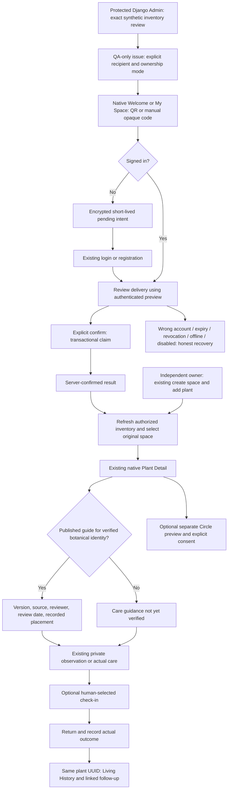

# Plantupia — integrated customer activation, care and QA

25 October 2026 · draft PR #241 · required branch `feature/plantupia-native-experience-20261012`.
This is the current implementation supplement to the canonical flow, Product Bible and screen ledger. Historical G1/G2 and October 20 maps describe their inspection dates. They do not describe the new native increment.

## Implemented product path



The four existing roots remain **My Space / Circle / Create / Me**. People, inbox, photos, Stories, Reels and messaging retain their existing routes and engines. Activation introduces no new root tab. Both customer paths reuse the existing care, idempotent event submissions, photo journal, follow-up, outcome and history code.

## Actual changes and boundaries

- Native `PlantupiaHandoverScreen`: one full-screen native flow with code, preview, explicit confirm and connected states. Welcome and signed-in My Space expose the contextual entry. Back closes it without claiming. “Not my delivery” removes the pending secret.
- QR uses JourneyApps ZXing Android Embedded 4.3.0 with the Activity Result `ScanContract`, QR format only, no saved barcode image or audible feedback. It decodes locally without a Google Play module download, supports the current minSdk 26, and uses existing camera permission. Manual entry remains available on denial, cancellation or camera failure. [Maintainer documentation](https://github.com/journeyapps/zxing-android-embedded#usage-with-scancontract).
- Pending codes use Android Keystore AES-GCM and AtomicFile in `noBackupFilesDir`, expire locally after 24 hours, and bind to the first authenticated account. Bound codes cannot resume on another account or while signed out. No token in URLs, saved instance state, logs, analytics, public payloads or permanent admin fields. Code UI uses secure-window protection and a password field. A process restart requires a fresh preview and explicit confirmation; it never auto-claims.
- Same-account confirmed retry returns the original space. An uncertain/offline response retains the code and requires retry; no locally fabricated inventory or success. Account/login generation guards reject stale callbacks. Successful activation refreshes server-authorized data and focuses the original space, including after a failed initial refresh is retried.
- Protected Django Admin issues an invitation once in a `no-store` response, explicitly requires recipient, QA ownership mode and QA acknowledgment, and exposes non-secret status/revocation. Reissue revokes unused predecessors. Claim/issue reject a space containing plants outside the reviewed manifest. Claimed previews recheck current access. Handover is now also refused when Django identifies the environment as production, even if the QA flag is mistakenly set.
- `BotanicalSpecies` is a curated identity, separate from user-entered `species_label`. Nullable `PlantUnit.verified_species` represents unknown identity. `CareGuideVersion` stores species/version, source URL/reference, instructions, contextual notes, staff reviewer, actual review date and publication state. Published content edits require a new version through Admin; a publication can be withdrawn. No botanical content is installed by default or company-approved. An optional **isolated QA seed** may populate three clearly labelled RHS-linked synthetic demonstration guides, which must never be presented as Plantupia's approved care advice.
- The private Care Guide panel lives in the existing Plant Detail view. It displays the latest published version for the curated identity, sources/review provenance and recorded placement, or an accurate unverified/unavailable/loading/retry state. Reading it never records care. No inferred environmental measurements, health score, diagnosis, recurring watering schedule or invented maintenance role.
- Local QA can compile a loopback/emulator-only API override into the `.qa` variant with `-PplantupiaQaApiUrl=http://10.0.2.2:8765/api/v1/`. It cannot modify release/debug production routing or target an arbitrary hosted server. Without the property the existing QA preview origin is preserved. QA and production package identities remain unchanged.

## Two distinct QA APK artifacts — read before demonstration

The PR CI intentionally builds **two separately named QA artifacts**:

1. `plantupia-qa-pr241-apk`: existing QA package using the project's configured QA preview origin. A successful build does **not** verify that a hosted QA service, its database, migrations, or data are available.
2. `plantupia-pr241-local-emulator-only-apk`: the same side-by-side `.qa` package with an explicit compile-time API URL of `http://10.0.2.2:8765/api/v1/`. `10.0.2.2` is Android **emulator-to-host** loopback, **not** a remote server or a physical phone address. This artifact can be used only with a separately running disposable local backend on that same development computer.

Do not relabel the emulator artifact as a physical-device APK or distribute it as a customer build. Installing either artifact alone does not create accounts, seed data, generate a QR, run Django, or enable handover. Both artifacts are short-retention CI outputs, not an operational release. The extra build only adds a safe demo artifact; it does not deploy, sign for Play, change the standard QA routing, or enable production.

### Operator rehearsal on a developer computer (disposable data only)

- Retrieve the **local-emulator-only** APK from the latest *successful exact-HEAD* PR Actions run. Extract it locally; never place invitations or test passwords in GitHub/CI.
- On that same computer, create a **fresh empty local SQLite database** and separate filesystem media, set `DJANGO_ENV=development`, `DJANGO_SECRET_KEY` to a local throwaway secret, `DATABASE_URL` to the fresh SQLite URL, `DJANGO_ALLOWED_HOSTS=localhost,127.0.0.1,10.0.2.2`, and `PLANTUPIA_HANDOVER_QA_ENABLED=1`. Do not use hosted credentials, production storage, or a database containing customer data.
- From `backend/`, install requirements, `python manage.py migrate`, then run `python manage.py seed_local_plantupia_qa --credentials-file <private-new-local-path-outside-repo> --with-sample-care-guides`. Keep the credentials file private; it contains four test-account passwords and a one-time handover code. Run `python manage.py runserver 127.0.0.1:8765`.
- Start an Android emulator attached to the **same host** and install the extracted `.qa` APK with `adb install -r <path-to-app-qa.apk>`. Log in with the synthetic intended customer, not the QA staff account. Use the stored raw code directly, or generate a QR locally that encodes **only that raw code**. Do not upload the code or QR to an online QR service.
- On the protected local Django Admin, sign in with the synthetic staff account to review the installation, inventory, invitation status and revocation/reissue. In Android, run preview -> explicit claim -> seven-plant My Space -> three visibly unapproved sample guides plus four unknown-guide states -> care -> check-in -> outcome -> Living History. Also try the unrelated QA user and the independent manual-add account.
- Delete the disposable database, media, secret/QR files and emulator state after the rehearsal. Do not report this as a physical-phone, production, push-delivery or hosted-isolation test.

**Acceptance boundary:** the emulator runtime path and app/core journey were exercised in the recorded October 25 implementation walkthrough, while the new separately named CI emulator artifact must itself pass *final-commit* CI and be checked before being described as a usable deliverable. A real-phone CEO demo requires an independently verified, approved QA backend reachable from that phone and a compatible build; `10.0.2.2` cannot supply that.

## Real Android phone on Windows — local USB acceptance (no hosted deployment)

**This is a third, distinct QA artifact, not a re-test of the previously successful emulator walkthrough.** CI also publishes `plantupia-pr241-physical-phone-usb-localhost-apk`, compiled with `http://127.0.0.1:8765/api/v1/`. Use it **only** while the Android phone is USB-connected to the same Windows computer running the disposable local Django backend and ADB reverse is active:

```powershell
adb devices
adb reverse tcp:8765 tcp:8765
```

Android then reaches the Windows computer's local server via the phone's `127.0.0.1:8765`. All usual app API routing, including login and Plantupia, uses this QA base URL; the production app package remains separate. The emulator-targeted `10.0.2.2` APK is **not** the correct physical-phone artifact.

For an explicit fresh test fixture on Windows, extract the new USB-only APK from the exact successful CI run, install Python 3.12 and Android Platform Tools (ADB), enable USB debugging and authorize that computer on the phone, then from the repository root run:

```powershell
powershell -ExecutionPolicy Bypass -File .\scripts\plantupia_local_phone_qa.ps1 -ApkPath "C:\path\to\app-qa.apk" -CreateLocalQr
```

The script deliberately sets `DJANGO_ENV=development`, an empty **new** SQLite database under the current user's local `PlantupiaQA` folder, a throwaway Django secret, no Redis/object-store credentials, an isolated media directory, and enables handovers **only** for that local fixture. It migrates the new database, seeds distinct staff/intended-recipient/stranger/independent QA accounts, seven unique synthetic plant records and three clearly unapproved care-guide examples, installs the side-by-side `.qa` APK and keeps Django running on `127.0.0.1:8765`. Optional QR is generated **offline on that PC** from the private fixture secret; manual code entry works without a QR.

- On the Windows PC open `http://127.0.0.1:8765/admin/`. Use the generated **staff** account, inspect the `Installations` and `Handover invitations` pages and the prepared manifest. The fixture creates a prepared invitation already; you may revoke/reissue through staff Admin, but doing so invalidates the old local code and requires the new code shown once.
- On the Android phone open the **QA** app with the **customer** fixture account. Scan the generated local QR or enter its code, review the authorized delivery, explicitly claim, then inspect all seven records inside My Space. Inspect care-guide available and unverified states; record an actual observation/photo and check-in; return, record an outcome, see linked Living History.
- Use the **stranger** account to prove authorization rejection; use the **independent** account to create a separate private space/plant. Review Me, Circle, People and Messages as appropriate, remembering that dummy Firebase configuration does not prove push delivery.
- The script prints **only** the private credential-file path, never the password or raw invitation; do not upload/share the local credentials or QR. The fixture lives in a new per-run directory in the current Windows user's local application data; remove that directory when finished. Disconnecting the cable invalidates the reverse tunnel until re-established.

**Boundaries:** this permits physical Android QA without a hosted staging service, **while USB/ADB is connected**. It does not prove production deployment, internet/cloud access, real customer invitations, push notifications, S3 storage or a wireless demonstration. Re-run `adb reverse` after USB reconnect. Only report successful physical-device evidence after a person has actually carried out the steps. If Python/ADB/setup fail on the user's machine, that must be resolved there rather than silently switching to Oracle production.

## Backend inventory

Existing preserved models: `Space`, `SpaceMember`, `PlantUnit`, `PlantNickname`, `PlantEvent`, `PlantDiscussion`, `PlantSubmission`, `InstallationBatch`, `InstallationManifestRow`, `HandoverInvitation`.

New models: `BotanicalSpecies`, `CareGuideVersion`. New nullable plant FK: `verified_species`.

New schema: `plants/0007_botanicalspecies_plantunit_verified_species_and_more.py`. This is additive. No migrations are applied to a hosted or production database. Rollout needs isolated environment/schema verification and an approved deployment.

Authenticated routes under `/api/v1/plantupia/`:

| Endpoint | Purpose |
| --- | --- |
| `POST handovers/preview/` | Existing G2 recipient-bound minimal summary; body `invitation` |
| `POST handovers/claim/` | Existing G2 atomic claim; body `invitation`, `confirm: true` |
| `GET plants/{uuid}/care-guide/` | New private guide/provenance/placement or explicit `unverified` state |
| `GET/POST spaces/`, `GET/POST plants/` | Existing shared manual entry and authorized inventory |
| `POST plants/{uuid}/event-submissions/` | Existing immutable account/plant/submission care and outcome identity |
| `GET plants/{uuid}/events/` | Existing Living History and `pending_followups=1` |

Staff-only Admin route: `/admin/plants/handoverinvitation/issue/`; no public invitation issuance endpoint. Revocation is an Admin action with the same batch-before-invitation lock order as claim and reissue.

## Demonstrate with synthetic data only

1. Use a fresh disposable **local SQLite** database and filesystem media. Set `DJANGO_ENV=development`, `DATABASE_URL` to that new local SQLite path, `DJANGO_ALLOWED_HOSTS=localhost,127.0.0.1,10.0.2.2`, and `PLANTUPIA_HANDOVER_QA_ENABLED=1`. Never use production credentials/storage.
2. From `backend/`, install existing requirements, run `python manage.py migrate`, then `python manage.py seed_local_plantupia_qa --credentials-file <new-private-local-file-outside-repo> --with-sample-care-guides`. The command refuses production, PostgreSQL, disabled handover, existing users/spaces and an existing credentials file. It creates only explicitly synthetic staff/customer/stranger/independent accounts and seven distinct original plant UUIDs. Credentials and the short-lived code go only to the requested local file.
3. Run this backend on `127.0.0.1:8765`. Build/install `.qa` with the loopback property above for the emulator. Firebase config can use the existing CI dummy configuration; it does not prove push delivery. Standard CI QA APKs retain the preexisting QA preview address, whose deployment/schema/isolation are not established by this build.
4. Open **Connect my Plantupia plants** at Welcome. Enter the private local code or a QR encoding exactly that raw opaque code. URLs/App Links are intentionally not accepted. Scan is not claim.
5. Continue to existing login with the synthetic intended customer. The pending code resumes. Select **Review my delivery**; confirm the synthetic space and seven-plant count. Select **Confirm and connect my plants**, wait for server confirmation, then **Open My Space**.
6. Confirm `Synthetic plant 01` through `07`, original UUIDs and placement, with no duplicate rows. Open one. Open Care Guide: unknown identity correctly shows unverified guidance. When `--with-sample-care-guides` is used, the first three distinct synthetic plant records have explicitly **unapproved QA example** care guides for Monstera deliciosa, Chlorophytum comosum and Sansevieria trifasciata, sourced to RHS; the remaining plants demonstrate unknown identity. This is not botanical sign-off.
7. Use the existing care form to record an observation, choose a future check-in and save. Confirm the actual record in Living History. Open its pending check-in, record an outcome, and verify the parent link and completed state. Viewing a guide and opening the form must not create records.
8. Reopen the same delivery with the same account; explicitly confirm and reopen. Verify seven original plants still exist. Repeat on the synthetic stranger account: preview/claim/private guide/history must fail without revealing the space/inventory. Test expiry, revoke and reissue via the isolated staff Admin.
9. Test an independent user without a code: existing registration/login → Create → private space → add plant → observation/care → check-in → outcome → Living History. No purchase or company service is required.
10. Test offline/online recovery, Back, rotation, process restart, logout/switch, camera denial, narrow screen and enlarged text. Open all four roots, People and inbox. Media playback, real push and remote storage require their own actual-media runtime cases; a code test is not acceptance of those capabilities.

## QA evidence and honest acceptance boundary

The actual emulator walkthrough reached all seven native inventory labels, unverified and explicitly synthetic published-guide states, a server-saved care record, a human-chosen check-in, app restart, outcome and linked Living History. Circle and Me also opened. A subsequent Edit Profile smoke test exposed pre-existing invalid `MNaN,NaN` vector backgrounds in two avatar hero assets and two art-lab vectors. Their original SVG rectangle omitted x/y (SVG defaults to zero); the four backgrounds now use `M0,0`, preserving the original artwork. A regression using the actual Compose path parser was observed failing before correction; a native test loads all sixteen hero/micro portraits. Final rerun evidence and remaining navigation/media cases belong in the delivery report, not a blanket device-acceptance claim.

PostgreSQL simultaneous same-account claim testing also exposed a joined `FOR UPDATE` result disappearing while another transaction changed the space owner. Issuance/claim now lock the base batch/space rows separately and invitation locking targets its base row. All three PostgreSQL claim-race cases passed in the subsequent full backend CI. Final source changes still require their own complete relevant CI.

Automated additions: handover parser/intent/account/expiry/error tests; real Android Keystore and signed-out login/registration continuation instrumentation; backend seven-identity claim→guide→care→lost-ack retry→follow-up→outcome→private history test; exact-manifest/production-disable/revoked-preview/Admin tests; guide publication/version/source/reviewer/authorization tests; simultaneous claim test using real row locks on PostgreSQL CI (intentionally skipped on SQLite).

Final command results, exact tested SHA, CI run links, downloadable APK and any actual emulator walkthrough are recorded in the delivery report and updated draft PR. Never infer final-head CI success from the previous G2 run or an earlier implementation commit. Instrumentation compilation and instrumentation execution are different evidence.

## Company approvals / unresolved release work

- Actual delivery manifest process, recipient verification/channel, ownership sale vs managed policy and staff access. The two G2 modes remain simulated QA choices.
- G2 targets **existing accounts**. A first-time customer must register before staff issues/reissues their account-bound code. Pre-account email invitation and install-to-App-Link routing are not implemented. The Android flow preserves registration intent but never bypasses a different intended recipient.
- Approved botanical identities, reviewers, content/source rights and local care guidance. Staff permission is technical authority, not proof of botanical credentials. No expert badge or substantive plant advice is fabricated.
- Approved HTTPS/App Links domain, customer distribution, independent hosted QA DB/media isolation, migrations, device/media/camera testing and final visual/accessibility acceptance.
- No contracted support, maintenance bookings, subscription, warranty, technician assignment, SLA, IoT, automatic watering or biological replacement workflow is offered. Those remain proposed/company-gated operations.
- The staging manifest is protected by the handover service and Admin, but upstream privileged direct ORM/DB amendments are not a complete immutable commercial inventory audit trail. Reviewed inventory amendments and staff-scoped organization permissions remain a rollout gate.
- Local pending codes are lost on uninstall/data clearing and cannot outlive server expiry. A bound intent is not available to another login account. There is no offline claim or automatic queued confirmation.
- Production, master, release signing and Google Play remain unaffected. PR stays **draft** and must not merge or deploy without explicit approval.

### Optional demo content safeguard (added after Codex)

The command `seed_local_plantupia_qa` accepts `--with-sample-care-guides` only while all its existing protections hold: development environment, QA flag, empty disposable SQLite database and fresh private credentials output. Three synthetic identity/guide pairs are created with public RHS source URLs, sample wording explicitly marked **SYNTHETIC QA DEMO — NOT APPROVED BY PLANTUPIA**, and a QA staff review identity. Remaining plants have no verified species or guide. Source text is summarized rather than copied, and a recorded review timestamp means fixture creation, **not actual Plantupia botanical sign-off**.

The synthetic demo does **not** alter production, enable handovers remotely, issue a real customer's invitation, or imply automatic watering advice. No specific plant count is a product constraint: the seven-plant fixture is convenient for tests only. Demo guides must not be imported to a real customer's installation.
